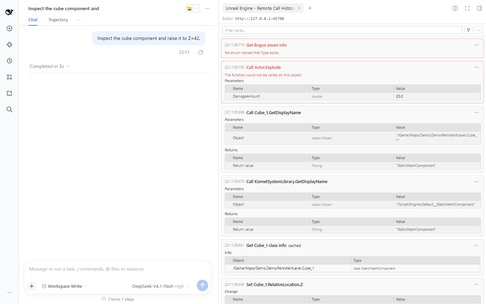
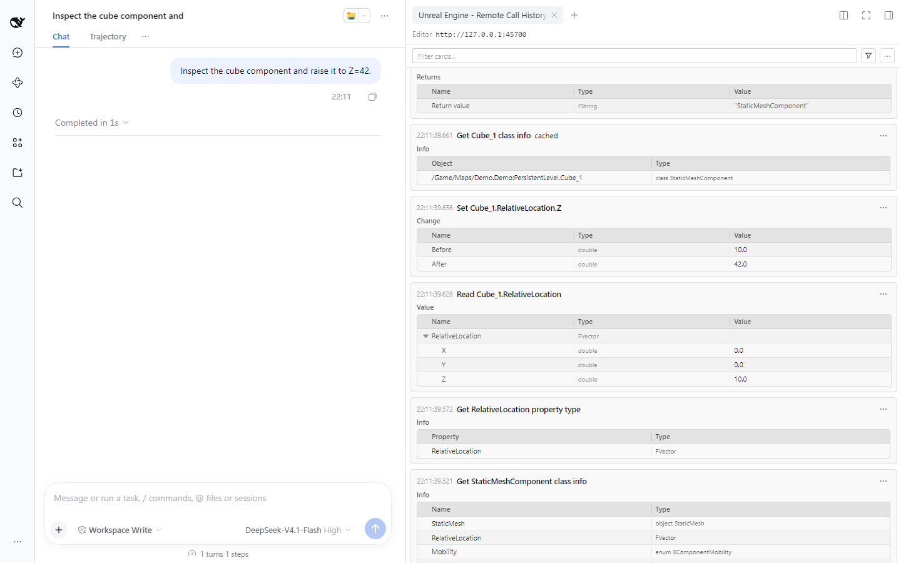
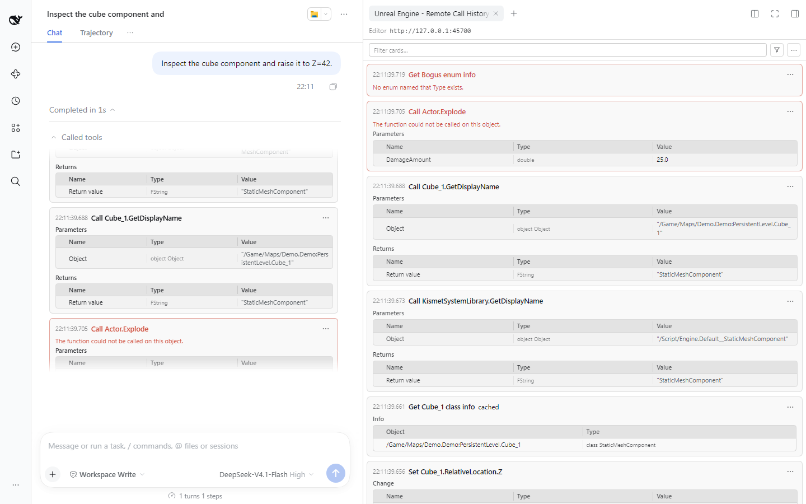

# dsh-unreal

**虚幻引擎 - 远程调用历史 / Unreal Engine - Remote Call History**

DeepSeek Harness plugin for the **Unreal EditorAutomation** plugin: model tools that
drive the editor through Unreal Engine's Remote Control Web API, plus a durable,
**per-session call history** in the right sidebar that renders each call as a
typed **Details** view.

The Unreal side is harness-agnostic — see
`<YourProject>/Plugins/EditorAutomation` (`EditorAutomationLibrary.h`, `README.md`). This
package is the DSH adapter: it exposes 72 `unreal_*` tools (core reflection,
PIE lifecycle/input/screenshot, editor diagnostics, Blueprint graph authoring,
Blueprint/level/asset helpers, and two optional UMG groups). **Every tool reaches
EditorAutomation through its generic `CallFunction` dispatcher** — tools keep a 1:1 name
with an EditorAutomation function, the wire call is always
`CallFunction(ObjectPath=<library CDO>, FunctionName=…, ParametersJson=…)`, and
EditorAutomation returns native values (no per-function result envelopes) with failures
logged for `unreal_get_recent_log`. Reflection answers are cached and every call
is recorded with typed Details so the user can review what the agent did.




## What it adds

| Surface | What it is |
| --- | --- |
| 94 model tools | core: `unreal_ping`, `unreal_get_editor_info`, `unreal_get_enum_info`, `unreal_get_struct_info`, `unreal_get_class_info`, `unreal_get_function_info`, `unreal_get_object_class`, `unreal_get_property_type`, `unreal_get_property_value`, `unreal_set_property_value`, `unreal_call_function`, `unreal_call_functions` (one-round-trip batch), `unreal_send_key`, `unreal_screenshot` (PIE game viewport or editor window), `unreal_get_recent_log` (in-memory editor diagnostics); Blueprint 6 + Blueprint-graph 16 + Level 6 + Asset 6 helpers; UMG runtime 6 and UMG design-time 15 tools in the optional `umg` / `umg_editor` groups (see `unreal_set_tool_groups`). All of them call through `CallFunction`. |
| Reflection schema cache | `Get*Info` answers cached in memory (TTL + single flight + bounded), so display/schema lookups are not re-fetched per call |
| Object→class cache | `GetObjectClass` answers cached per object path, so a level instance is typed once and reused |
| Durable history | One record per call in the `dsh_unreal` storage domain, with the typed Details embedded in the record |
| Right-sidebar action log | Each record is one always-open card led by a localized action title (`读取 Cube_1.RelativeLocation`, `Call Cube_1.GetDisplayName`); parameters/returns/value changes are visible immediately, a failed card's title is red with one short error line, and time/status/call id/counts/canonical Types/legacy note/raw JSON/error code+hint live behind the card's one Raw data menu item |
| Transcript tool views | Every tool call in chat draws the SAME card through a keyed `tool.call.toolview` (one registration per tool, each guarded): running calls show a compact card with the action title and available arguments, settled calls fetch their durable record by `callId` and render the identical card — so the chat and the sidebar are one design |

## Wire contract

Every tool call is the same Remote Control request:

```
PUT http://127.0.0.1:30010/remote/object/call
{ "ObjectPath": "/Script/EditorAutomation.Default__EditorAutomationCoreLibrary",
  "FunctionName": "<EditorAutomation function>",
  "Parameters": { ... } }
→ { "ReturnValue": <result struct or return value> }
```

The Engine's field names are PascalCase (`ObjectPath`, `FunctionName`,
`Parameters`); `FJsonObjectConverter` standardizes the first character's case, so
the lowercase spellings in the EditorAutomation README's smoke snippet are accepted too.

**Nested JSON text is the convention that matters:**

- struct members keep their C++ names;
- every scalar is a JSON **string** (`"12.5"`, `"true"`, `"Cube"`);
- enum values are **numbers** (resolve them with `unreal_get_enum_info`);
- `ValueJson`, `OldValueJson`, `NewValueJson`, `ParametersJson`,
  `ReturnValueJson` and `OutParametersJson` are strings that contain JSON;
- Type strings are canonical: `class(...)`, `struct(...)`, `enum(...)`,
  `object(...)`.

The adapters return both the Engine's raw text and, where it parses, the parsed
value (`valueJson` + `value`, `returnValueJson` + `returnValue`, …), so the model
can read either form.

## Tools

| Tool | EditorAutomation call | Parameters → result highlights |
| --- | --- | --- |
| `unreal_ping` | `Ping` | — → `{ pong: true, value: "pong" }` |
| `unreal_get_enum_info` | `GetEnumInfo` | `type` → `{ path, count, rows: [{name, displayName, value}], text }` |
| `unreal_get_struct_info` | `GetStructInfo` | `type` → `{ path, count, rows: [{name, type}], text }` |
| `unreal_get_class_info` | `GetClassInfo` | `type` → `{ path, properties, functions, propertyCount, functionCount, text }` |
| `unreal_get_function_info` | `GetFunctionInfo` | `type`, `functionName` → `{ parameters, returnType, text }` |
| `unreal_get_object_class` | `GetObjectClass` | `objectPath` → `{ objectPath, classType }` (cached per path) |
| `unreal_get_property_type` | `GetPropertyType` | `type`, `propertyPath` → `{ propertyType }` |
| `unreal_get_property_value` | `GetPropertyValue` | `objectPath`, `propertyPath` → `{ valueJson, value }` |
| `unreal_set_property_value` | `SetPropertyValue` | `objectPath`, `propertyPath`, `valueJson` \| `value`, `generateTransaction?` → `{ oldValueJson, newValueJson, changed }` |
| `unreal_call_function` | `CallFunction` | `objectPath`, `functionName`, `parametersJson` \| `parameters`, `generateTransaction?` → `{ returnValueJson, returnValue, outParametersJson, outParameters, returnType, returnedNothing }` |
| `unreal_call_functions` | `CallFunctions` | `calls: [{ objectPath, functionName, parametersJson \| parameters, generateTransaction? }, …]` → `{ batchSuccess, calls, results: [{ index, ok, errorCode, … , returnValueJson, returnValue, … }], failed }`; one round trip for a known list of calls, sequenced in order |
| `unreal_screenshot` | `CaptureScreenshot` | `target?: "game" \| "editor"` (default `game`), `filePath?`, `showUI?`, `waitMs?` → `{ target, filePath, requested, exists, bytes, waitedMs }`; the game target captures the PIE game viewport and waits for the engine to write the PNG, `editor` captures the editor window synchronously |
| `unreal_get_recent_log` | `GetRecentLog` (through `CallFunction`) | `maxLines?`, `minVerbosity?` (`fatal`/`error`/`warning`), `categoryFilter?`, `clear?` → `{ entries: [{ time, verbosity, category, message }], count, truncated, totalRecorded }`; reads EditorAutomation's in-memory ring buffer, so no log files are touched |
| `unreal_get_blueprint_info` | `GetBlueprintInfo` (through `CallFunction`) | `blueprint` → `{ assetPath, assetClass, parentClass, generatedClass, blueprintType, status, dirty, beingCompiled }`; an empty path means the asset could not load |
| `unreal_set_blueprint_dirty` / `unreal_compile_blueprint` / `unreal_save_blueprint` / `unreal_delete_blueprint` | the matching library function, through `CallFunction` | `blueprint` (and `dirty` for set) → `{ success: true, … }`; a native `false` becomes an `editorautomation/<Function>Failed` tool error pointing at `unreal_get_recent_log` |
| `unreal_create_blueprint` | `CreateBlueprint` (through `CallFunction`) | `assetPath`, `parentClass`, `blueprintType?` → `{ success: true, assetPath, … }` |
| `unreal_get_current_level_info` / `unreal_is_current_level_dirty` / `unreal_get_level_script_blueprint` | matching level functions, through `CallFunction` | → `{ levelPath, levelName, dirty }` / `{ dirty }` / `{ levelScriptBlueprint }` |
| `unreal_create_level` / `unreal_open_level` / `unreal_save_current_level` | matching level functions, through `CallFunction` | → `{ success: true, … }`; native `false` becomes `editorautomation/<Function>Failed` with a log hint |
| `unreal_get_blueprint_graphs` / `unreal_get_graph_nodes` / `unreal_get_node_pins` | `GetBlueprintGraphs` / `GetGraphNodes` / `GetNodePins` (through `CallFunction`) | `blueprint` / `graph` / `node` → `{ graphs }` / `{ nodes }` / `{ pins }`, pins include `LinkedPinIds` for exec-chain tracing |
| `unreal_add_call_function_node` / `unreal_add_event_node` / `unreal_add_branch_node` / `unreal_add_component_bound_event_node` / `unreal_add_variable_get_node` / `unreal_add_variable_set_node` | matching graph functions, through `CallFunction` | graph + function/event/variable parameters → `{ nodeObjectPath }`; empty result becomes an `editorautomation/<Function>Failed` error with a log hint |
| `unreal_add_blueprint_variable` / `unreal_connect_pins` / `unreal_set_pin_default_value` / `unreal_set_pin_default_object` / `unreal_set_node_position` / `unreal_remove_graph_node` / `unreal_remove_graph_nodes_by_class` | matching graph functions, through `CallFunction` | → `{ success: true, … }` / `{ removed }`; native `false`/empty failures point at `unreal_get_recent_log` |
| `unreal_send_key` | `SendKeyToPIE` | `keyName`, `focusViewport?` → `{ bSuccess, ErrorMessage }`; simulates one key press (down + up) inside the running PIE session, e.g. `Up`, `Left`, `R`, `Space` |

Blueprint and level tools (like `unreal_get_recent_log`, `unreal_screenshot` and
`unreal_call_function`) reach EditorAutomation through its generic **`CallFunction` dispatcher**:
tools keep a 1:1 name with an EditorAutomation function, but the wire call is always
`CallFunction(ObjectPath=<library CDO>, FunctionName=…, ParametersJson=…)`. That keeps one
calling convention (call-level failures come back uniformly) while the native return value
arrives as nested JSON. Functions that report failure through a native `false` are surfaced as
tool errors with a hint to read `unreal_get_recent_log` for the engine reason.

PIE input reaches a game's `PlayerController` only while the **game viewport** owns
keyboard focus. `unreal_send_key` is the harness-side way to guarantee that; a
focusable UMG widget that calls `SetKeyboardFocus` steals focus from the viewport
and makes physical keys silently do nothing. Screenshot capture brings the PIE
viewport forward with Slate and sets keyboard focus without touching the
PlayerController's cursor or input mode, so taking a screenshot does not hide the
in-game mouse cursor.

EditorAutomation's `CallFunction` dispatcher reports call-level failures (unknown object or function,
parameter JSON that does not match the signature) as a result envelope: the tool raises them as
`editorautomation/<Function>Failed` errors instead of returning them as data. Functions that report
failure through a native `false` are raised the same way, with a hint to call
`unreal_get_recent_log` for the engine's own reason. Transport failures use the `rc/*`
vocabulary (`rc/unreachable`, `rc/timeout`, `rc/unauthorized`, `rc/bad-response`, …).

## Reflection schema cache

The `Get*Info` entry points exist so a caller can learn the editor's **shape**
(enum entries, struct members, property types, function signatures). That shape
changes only when the editor reloads, so the plugin caches it in memory once and
serves both the tools and the history enrichment from it:

- **Keyed** by operation + every argument that changes the answer
  (`GetFunctionInfo|<Type>|<FunctionName>`, `GetPropertyType|<Type>|<PropertyPath>`, …).
- **TTL** (`reflectionCacheTtlMs`, default 5 min; `0` = never stale).
- **Single flight**: concurrent misses for one key share a single request, so a
  burst of tool calls costs one round trip per distinct key.
- **Bounded** (`reflectionCacheMaxEntries`, oldest evicted); a failed load is
  never cached.
- **Invalidated on transport failure** (`rc/unreachable`, `rc/timeout`, …): the
  editor may be a restarted process, so every stored shape is dropped. Editor
  answers (an `ErrorCode`) do *not* clear it — they are answers, not outages.
  A config change/remount starts a fresh cache.

**Object→class cache.** `GetObjectClass` answers are cached the same way, keyed
by the full object path. A level instance's path names no class, so this is how
the history row gets a class schema at all: `unreal_get_object_class` resolves
it once, and every read/write/call enrichment on that instance reuses it (TTL,
single-flight and transport invalidation included). A build without
`GetObjectClass` (an older editor, or the e2e stand-in before it answered this
route) is handled as "no class known": the call still succeeds, and the row
degrades to values without type labels.

The cache is **memory only** and dies with the host; the history does not depend
on it. Tool results report `cached: true` when the answer came from the cache,
and the panel shows a `cached` badge on those rows.

## Typed Details in every history row

Each record embeds a `details` structure built at record time from the cached
reflection schema — so the panel renders a Details view without touching the
editor, and rows stay readable after a host restart:

- `unreal_call_function`: a **Parameters** table (`name`, `type`, `direction`,
  `value`, with omitted parameters marked *default*), the typed **return** value,
  and **out parameters** typed from the signature.
- `unreal_set_property_value`: a typed **before → after** change.
- `unreal_get_property_value`: the property's canonical **Type** plus the value.
- Reflection tools: their info payload is rendered structurally (entries,
  members, properties/functions, signature) from the stored `result`.
- Nested structs/arrays/maps expand recursively in the panel; struct members get
  their types from the struct cache, and numeric enum values get an entry label.

Types are shown as **short labels** in the tables (`struct Vector`,
`class StaticMeshComponent`, `enum ECollisionEnabled`), with the full canonical
Type on the cell's `title` and in the Raw data JSON; the Type column never wraps
mid-identifier.

**The card layout is an action log.** Each record is one always-open card led by
a localized, action-first title composed from the record's fields:

| Tool | English | 中文 |
| --- | --- | --- |
| ping | Check connectivity | 检查连通 |
| get_enum_info | Get ECollisionEnabled enum info | 获取 ECollisionEnabled 的枚举信息 |
| get_struct_info | Get Vector struct info | 获取 Vector 的结构信息 |
| get_class_info | Get StaticMeshComponent class info | 获取 StaticMeshComponent 的类信息 |
| get_function_info | Get GetClosestPointOnCollision function info | 获取 GetClosestPointOnCollision 的函数信息 |
| get_property_type | Get RelativeLocation property type | 获取 RelativeLocation 的属性类型 |
| get_object_class | Get Cube_1 class info | 获取 Cube_1 的类信息 |
| get_property_value | Read Cube_1.RelativeLocation | 读取 Cube_1.RelativeLocation |
| set_property_value | Set Cube_1.RelativeLocation | 设置 Cube_1.RelativeLocation |
| call_function | Call Cube_1.GetDisplayName | 调用 Cube_1.GetDisplayName |

Parameters/Returns/value changes and reflection listings are visible immediately —
there is **no outer expand/collapse**. A failed card paints its whole title red
and shows one short error sentence (the code/hint are raw material). The card's
single **Raw data / 原始数据** radio item in its three-dot menu reveals the
timestamp, status, tool, duration, call id, cached flag, entry counts, canonical
Type echoes, legacy note, raw params/result JSON and the error code/message/hint.
Nested value trees still expand inline — that is value interaction, not a second
record fold.

The **transcript tool view** (`src/client/toolview.tsx`) registers one keyed
`tool.call.toolview` per tool name and mounts inside the chat's tool call. Its
three stages:

- **preparing/start** — a compact card in the same visual language: the call's
  time, an action title derived from the arguments that have arrived
  (`Read Cube_1.RelativeLocation` as soon as object + property are known), the
  available Parameters, and a subtle pulsing “Running…” state;
- **result** — the durable history record is looked up through the existing
  `/dsh-unreal snapshot` channel by `callId` (session id from the seat prop or
  the structural resolver; 16 bounded polls × 700 ms) and the exact
  `OperationCard` the sidebar renders is drawn, with the same menu;
- **fallback** — if no record can be fetched, a compact card built from the
  block's own args and result text, with a “Partial” marker instead of a blank.

No client package is imported as a runtime value (the props are read
structurally), so a host without the tool slot keeps the sidebar panel and a
refused registration costs only that one card.

Details are bounded (`detailsMaxChars`, deep values truncated, oldest sections
dropped with `truncated: true`; the truncation flag is Raw data) and enrichment
is time-bounded (`enrichmentTimeoutMs`, default 2 s) so it can never delay a
tool result indefinitely. **Old records** written before Details existed keep
the same card layout: their body is just the Raw data menu, and the legacy note
appears only inside it.



**Design trade-off:** class schema is derived from Unreal's naming conventions
(`Default__<Class>` CDOs, `_C` Blueprint classes, `/Script/...` class objects)
first — no round trip — and only falls back to the cached `GetObjectClass` for
paths those cannot describe (level instances). A build without `GetObjectClass`
degrades to values without type labels. The error-code names in
`kit/types.ts` were verified against the landed header (`none`,
`invalid-argument`, `object-not-found`); unknown numbers degrade to
`error-<n>`.

## Durable call history

Every tool call — success or failure — becomes one record in the storage domain
`dsh_unreal` (per-record JSON layout, under `<DSH_HOME>/storages/dsh_unreal/`):

```ts
{
  id, time, sessionId?, callId?, tool, ok, recordVersion?,
  errorCode?, errorMessage?, errorHint?, durationMs?,
  targetType?, objectPath?, propertyPath?, functionName?, propertyType?,
  params?, result?, resultSummary?,
  cached?, details?
}
```

`recordVersion` marks the schema generation (`2` for records written by this
build); its absence is what makes a row read as a pre-Details legacy record on
the card. `params` and `result` are bounded by `snapshotMaxChars` (oversized
payloads degrade to a truncated string), `details` by `detailsMaxChars`, and the
whole table is capped by `maxRetainedOperations`, oldest first.

**Session filtering:** records carry the DSH session id (`exec.agent.id`), and
the history channel answers a `snapshot` request with the rows for the
`sessionId` the panel names — never the page-wide list. A panel that cannot name
a session gets zero rows and says so; the header still reports the total number
of sessions and records (counts only). The tab body is a session-scope slot, so
the sidebar framework hands it the current session id; a structural fallback
reads the session list's selection for hosts that compose it differently.

## Configuration

| Key | Default | Meaning |
| --- | --- | --- |
| `baseUrl` | `http://127.0.0.1:30010` | Remote Control Web API origin |
| `passphrase` | — | Plaintext passphrase; sent as the MD5 hex the Engine compares |
| `requestTimeoutMs` | `30000` | Per-request budget |
| `preflight` | `true` | Probe `Ping` once at mount and log the answer |
| `historyLimit` | `100` | Rows one history read returns when the caller names no limit |
| `maxRetainedOperations` | `500` | Retained rows across all sessions |
| `snapshotMaxChars` | `4000` | Cap on one stored params/result payload |
| `reflectionCacheTtlMs` | `300000` | Reflection cache freshness; `0` never goes stale |
| `reflectionCacheMaxEntries` | `512` | Maximum cached reflection answers |
| `detailsMaxChars` | `12000` | Character budget for one record's typed Details |
| `enrichmentTimeoutMs` | `2000` | How long enrichment may spend before the record is written without Details |

`DSH_UNREAL_BASE_URL` overrides `baseUrl` when set (the seam the e2e suite uses
to point the transport at a stand-in endpoint).

## Install

```powershell
dsh plugin --profile web add C:\PROJECTS\dsh-unreal
# or add the entry to the profile's dsh.profile.bundles yourself
```

The bundle layer contributes one row (`cordis.patch.yml`):

```yaml
- insert:
    - id: unreal
      name: dsh-unreal
```

## Develop

```powershell
pnpm install
pnpm run build          # tsc host half + tsdown browser bundle
pnpm test               # node:test unit suite (135 tests)
pnpm run e2e            # Playwright: real dsh web + real browser (20 tests)
pnpm run screenshots    # regenerates docs/images/*.png (README_SHOTS)
node scripts/real-editor-smoke.mjs   # optional: against a live editor on :30010
```

The e2e suite boots a throwaway `dsh web` against a temporary `DSH_HOME`, links
this checkout into its profile, and has a fixture plugin drive the plugin's real
tools against a stand-in Remote Control endpoint — so the history the browser
renders is the plugin's own durable history, with no editor, model or key
involved. The fixture answers the enrichment reflection calls **including
`GetObjectClass`**, and the spec asserts the caches prevented duplicate requests,
that a level-instance call is typed through the object→class cache, that every
card is already open with an action title, that a failed title is red with one
short error line, and that the only record fold is the Raw data menu item
(timestamp/call id/counts/canonical Types/legacy note/raw JSON/error code+hint
live there). A second boot runs the same assertions against the exact Chinese
titles. A third boots the transcript: one custom card per fixture call, the same
title/Parameters/Returns as the sidebar card, the red failed title, the menu’s
Raw data block, and the sidebar still working beside it. One row is seeded in
the pre-Details record shape to prove the legacy card. Set `DSH_BIN` when `dsh`
is not on `PATH`.

The seven README figures:

| Figure | Shows |
| --- | --- |
| `history-cards.png` | the always-open cards, mixed success/failure with a red failed title |
| `history-card-call.png` | a level-instance call card: Parameters + Returns already open |
| `history-card-details.png` | a read card with its typed value tree expanded inline |
| `history-card-raw.png` | one card's Raw data block, opened from the three-dot menu |
| `history-card-menu.png` | a card's three-dot menu with its Raw data radio item |
| `history-cards.zh.png` | the same cards with the requested Chinese action titles |
| `history-toolview.png` | the same card rendered as a custom tool view inside the chat transcript |



## Layout

```
src/index.ts        plugin entry: client, cache, store, history channel, tools
src/config.ts       Schemastery config
src/records.ts      zod record schema (incl. the embedded Details shape)
src/store.ts        dsh-storage-domain store + session grouping
src/rpc.ts          host side of the panel's history channel
src/schema-cache.ts TTL + single-flight + bounded reflection cache
src/details.ts      typed call enrichment (Parameters/Returns/change/bounds,
                    class resolution incl. the GetObjectClass cache fallback)
src/tools.ts        the ten tools + audit/enrichment wrapper
src/kit/            EditorAutomation wire types, HTTP client, result/error mapping,
                    cached reflection service (schema + object→class)
src/client/         browser half: dock, panel, card-title, details-view,
                    raw-data, toolview (+ model), type-label, wire, locales, CSS
tests/              node:test unit suite (real storage stack included)
e2e/                Playwright suite + fixtures
```
