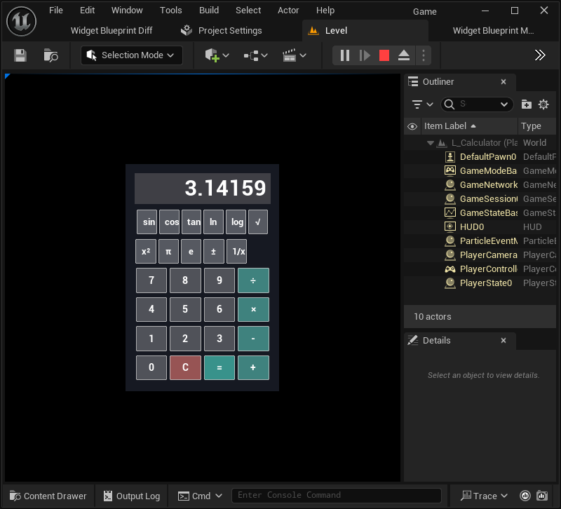

# Scientific Calculator E2E

```text
Level
  │ BeginPlay
  ▼
Create Widget
  │
  ▼
WBP_Calculator
  │
  ▼
AddToViewport
  │
  ▼
PIE
```



```text
WBP nodes: 288
PIE roots: 1
Compile:   0 errors
```

```text
WBP_Calculator
  └─ EventGraph (pure Blueprint)
       ├─ 27 × Button.OnClicked
       ├─ Entry / Acc / Pending
       ├─ 10 × digit chain
       ├─ 4 × operator chain
       ├─ = / C chain
       └─ 11 × scientific chain
```

```text
√8       → 2.82843
sin 30°  → 0.5
2²       → 4
log 100  → 2
π        → 3.14159
e        → 2.71828
1/2      → 0.5
cos 60°  → 0.5
tan 45°  → 1
ln e     → 1
12 + 3 = → 15
√-1      → Error
ln 0     → Error
1/0      → Error
```

## 状态

```text
Level 加载 WBP    ✅
纯 Blueprint 逻辑  ✅
科学函数           ✅
计算器 C++         ❌ 无
```

## 限制

```text
立即执行，无运算优先级
固定角度制
最多 5 位小数
无 DEG/RAD、括号、小数点、历史
```
