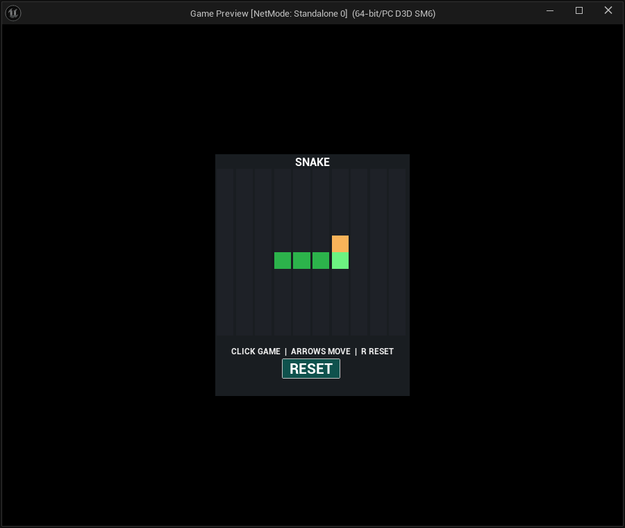
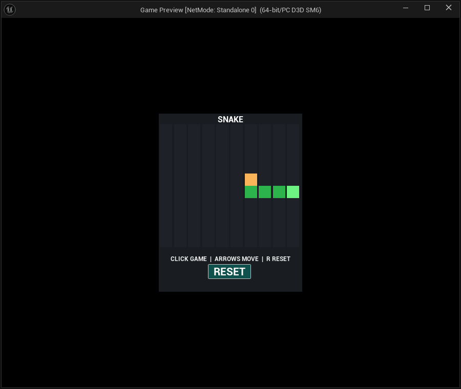

# Snake E2E

```text
Level L_Snake
  │ Level Blueprint BeginPlay
  ▼
Create Widget / WBP_Snake
  │
  ▼
AddToViewport
  │
  ▼
Event Construct → 初始化 Head/Body/Dir/Counter
  │
  ▼
Event Tick → 100 格渲染 → Body2 → Body1 → Head → Dir → Counter → GameOver
  │
  ▼
WBP_EventGraph（纯 Blueprint，无 C++ 业务逻辑）
```





## 这次修了什么

修复前：PIE 里蛇完全不动，键盘方向键（偶尔）能改变方向变量，但没有可见移动。
EventGraph 有 914 个节点，是之前自动生成后"断链"的状态。

### 1. Tick / Construct 执行链断裂

```text
Event Tick → SetBrushColor ×100 → (断)
Event Construct → SetHeadR… → (断)
```

修复：把 `Tick.then` → 渲染链 → 状态更新链接起来，`Construct.then` → 初始 10 个变量 → `SetKeyboardFocus`。

### 2. 移动逻辑数据子图损坏

旧图里 25 个 `Select Int` / 8 个 `AND` / 5 个 `OR` / 5 个方向键节点互相乱连，
`Set HeadR` 的值依赖了错误的比较结果（`Dir` 永远算出 0）。

修复：整段删除后重建为无分支纯数据选择链（纯 Blueprint）：

```text
方向键(Up/Down/Left/Right) → Select Int 链 → newDirR / newDirC
反向保护：newDir == -oldDir 时保持原方向
每 20 个 Tick 移动一格：Counter + 1 >= 20
candidate = Head + Dir
撞墙 / 撞身体 → GameOver = 1 并冻结
R 键 → 复位
```

### 3. 渲染 300 个 Equal 全部是常量比较（蛇永远画不出来）

每个格子的 `Equal (Integer)` 三个节点本应比较「本格索引」和「头/身1/身2 索引」，
但生成时 `A=0` 是常量、`B=格子序号` 也是常量：

```text
Equal(0, cellIndex)          # 永远只对 0 号格成立
```

修复：新增 3 组索引计算（纯 Blueprint 数据节点）：

```text
HeadIndex  = HeadR  * 10 + HeadC
Body1Index = Body1R * 10 + Body1C
Body2Index = Body2R * 10 + Body2C
```

然后把 300 个 Equal 的 `A` 逐一接到对应索引，`B` 保留格子序号：

```text
cell == HeadIndex   → 亮绿（头）
cell == Body1Index  → 中绿
cell == Body2Index  → 深绿
否则                → 背景色
```

### 4. 执行顺序错误导致身体塌陷

原顺序是 `Head → Body1 → Body2`：`Body1` 读取 `Get HeadR` 时 Head 已经被赋值，
所以身体永远等于新头（3 节蛇退化成 1 节）。

修复：把执行链重排为：

```text
Body2 → Body1 → Head → Dir → Counter → GameOver
```

这样 Body1 读到的是旧 Head，Body2 读到的是旧 Body1。

### 5. 焦点被 Widget 抢走（方向键无效的真正原因）

第一版修法把 `bIsFocusable` 设为 `true` 并在 Construct 里 `SetKeyboardFocus(self)`，
虽然 Message Log 的 focus 警告消失了，但**物理键盘从此进不了游戏**：

```text
PIE 窗口 → Slate 键盘焦点 = WBP_Snake 根 Widget
         → 按键事件在 UMG 树上冒泡，到不了 SViewport
         → PlayerController.WasInputKeyJustPressed 永远 false
```

表现就是「蛇在动，但方向键完全没反应」。
用同样事件注入手动验证过：`ProcessKeyDownEvent` 直送焦点控件时方向会变，
而真实键盘路径不会 —— 因为焦点不在 GameViewport 上。

修复（标准 UMG 游戏输入做法，纯 Blueprint）：

```text
删除 Set Keyboard Focus
bIsFocusable = false
Event Construct 末尾：
  SetInputMode_GameOnly(PlayerController)   ← 输入交给游戏
  SetFocusToGameViewport()                  ← 键盘焦点交给 GameViewport
On Clicked (BtnReset) 末尾：
  SetFocusToGameViewport()                  ← 点完按钮把焦点还给游戏
```

这样方向键 → GameViewport → SViewport → GameViewportClient → PlayerController，
`WasInputKeyJustPressed` 正常。用 Win32 消息直接投递到 PIE 窗口也验证通过。

### 6. 食物与增长（纯 Blueprint，2026-11-15 追加）

增长需要"任意长度身体"，固定 3 个 Body 变量不够，所以改用 **数组环形缓冲**：

```text
SnakeCells : int32[]   // 100 槽环形缓冲，值 = 格子索引 + 1000（避开默认空槽的 0）
HeadSlot   : int32     // 蛇头所在槽位
SnakeLength: int32     // 当前长度
FoodIdx    : int32     // 食物格索引
ResetPending / DoMove / NewGO / CandIdx / SlotNextV / LenNewV / TailSlotV / HeadValV / AteV
```

每 Tick 顺序（关键：**先冻结本帧计算值，再改状态变量**）：

```text
渲染 100 格（食物橙 / 头亮绿 / 身形中绿，身体用 Array Contains 判断）
Set CandIdx      = 旧头 + 方向 的格子索引
Set NewGO        = 已有 GameOver OR 撞墙 OR 撞身体
Set DoMove       = 到了移动间隔 AND NOT NewGO
Set SlotNextV / LenNewV / TailSlotV / HeadValV / AteV   // 冻结
Set HeadR/HeadC/DirR/DirC/Counter/GameOver
Branch(ResetPending==1)
  True  → 清空数组、重播 3 节初始蛇、HeadSlot=2、Length=3、FoodIdx=55、清 ResetPending
  False → Branch(R 键)
            True  → Set ResetPending=1
            False → 环形推进：清尾槽 → 写新头槽 → Length/FoodIdx 更新
```

吃食物：`Ate = DoMove && (CandIdx == FoodIdx)`；吃到时 `Length+1`（不删尾）并
`FoodIdx = (FoodIdx*37 + 11) % 100`，否则删尾保持长度。
新加 EditorAutomation 支撑 API：`AddBranchNode`、数组类型变量（`int32[]` / `array(int32)`）、
数组函数自动使用 `K2Node_CallArrayFunction`（否则通配符引脚编译报 undetermined）。

## 验证记录

运行时属性读取（PIE widget 实例）：

```text
开局     : Head=(5,3) SnakeLength=3 FoodIdx=55 蛇头正前方有食物
吃食物   : SnakeLength=3→4，FoodIdx=55→46（重算公式），数组槽=1053..1056
移动     : 每次移动 HeadSlot+1、清尾槽、写新头槽，窗口外槽位清 0
撞右墙   : HeadC=9 GameOver=1，蛇头停在 9（不再越界）
Reset R  : Head=(5,3) SnakeLength=3 FoodIdx=55 GameOver=0，数组恢复三节
```

输入验证（EditorAutomation 自带的 PIE 输入工具，不经 SlateBot）：

```text
SendKeyToPIE("Up")  → DirR=-1 DirC=0           ✅
SendKeyToPIE("R")   → GameOver 1→0 Head=(5,3)  ✅
FocusPIEViewport()  → { bSuccess: true }       ✅
```

真实键盘路径（Win32 消息投递 PIE 窗口，验证焦点修复）：

```text
WM_KEYDOWN(Up) → DirR=-1 DirC=0   ✅
WM_KEYDOWN(R)  → Head=(5,3) GameOver=0 ✅
```

截图：

| 文件 | 内容 |
| --- | --- |
| `snake.png` | 吃到食物后蛇变长（4 节），前方橙色食物 |
| `snake_gameover.png` | 撞右墙后 GameOver 冻结（4 节蛇） |

## 状态

```text
Level 加载 WBP        ✅
纯 Blueprint 逻辑      ✅（EditorAutomation 不含任何游戏业务 C++）
Tick 驱动自动前进       ✅
方向键转向             ✅（含反向保护）
撞墙 / 撞身体 → 结束    ✅
食物 → 变长 + 食物重刷   ✅
R 键 / RESET 按钮复位   ✅
渲染食物/头/身三色       ✅
编译器 0 error        ✅
```

## 限制

```text
10×10 固定地图，无计分 UI
食物随机公式简单，可能短暂落在蛇身上（被吃掉即重刷）
每 20 Tick 移动一格（60fps 约 3 格/秒）
GameOver 后蛇冻结，只能复位
```

## 备注（调试能力）

- 通过 `GetNodePins` 的新字段 `LinkedPinIds` 做 exec 链正向追踪，定位断链位置。
- PIE 属性读取 + `register_slate_post_tick_callback` 做逐帧状态采样（确认 Tick 是否执行）。
- `EditorAutomationLibrary.FocusPIEViewport` / `SendKeyToPIE`：把 PIE 键盘焦点还给 GameViewport 并注入按键，
  已在 `dsh-unreal` 中暴露为 `unreal_focus_pie` / `unreal_send_key`（不依赖 SlateBot）。
- 嵌入 PIE 时若 Level 视口标签不可见，UMG Tick 不执行；改用 Play in New Window 验证。
- UMG 游戏要收到物理键盘：焦点必须在 GameViewport 上，**不能**给根 Widget `SetKeyboardFocus`。
